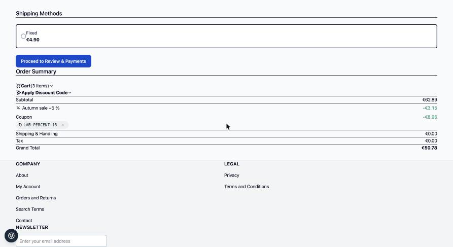
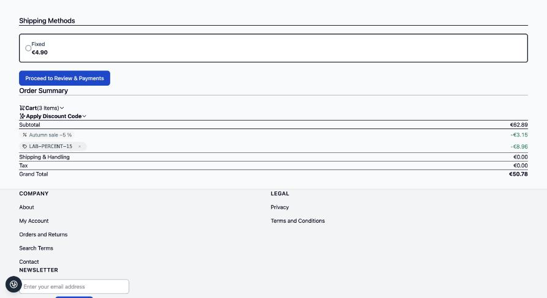
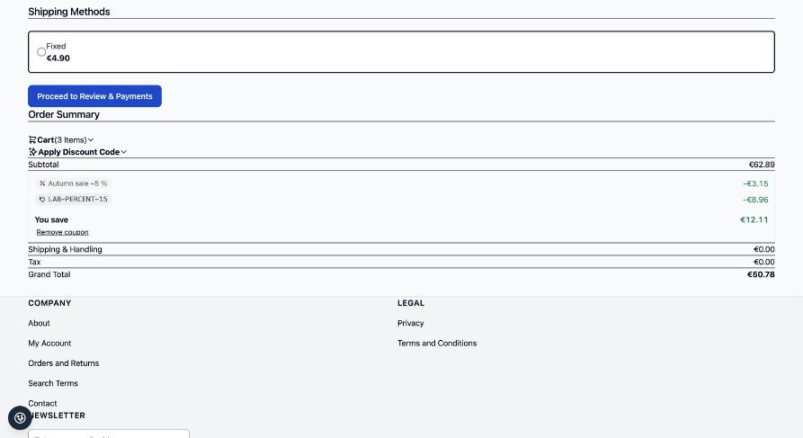
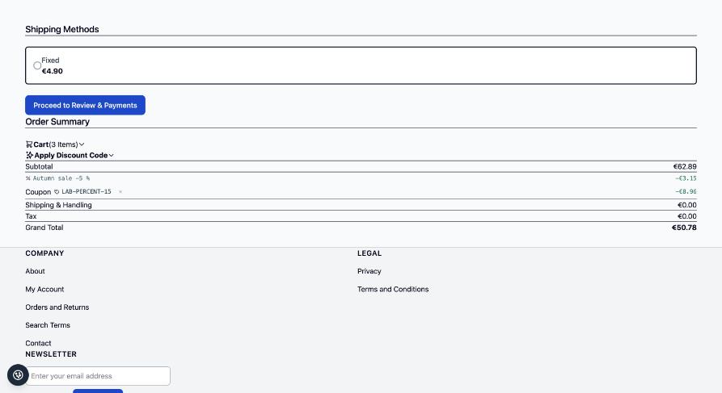
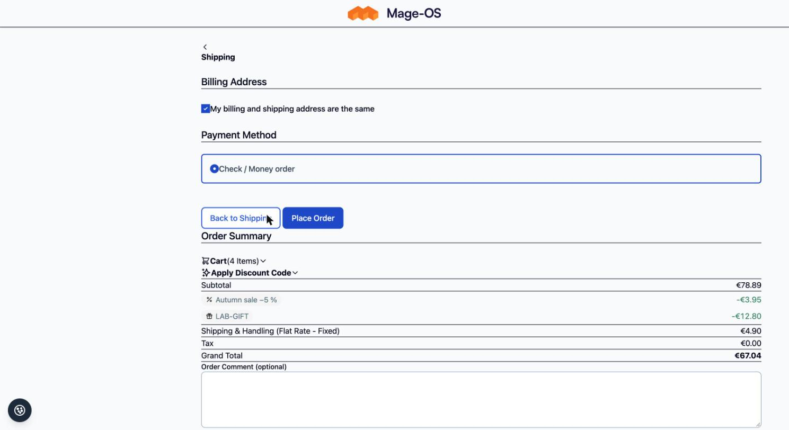
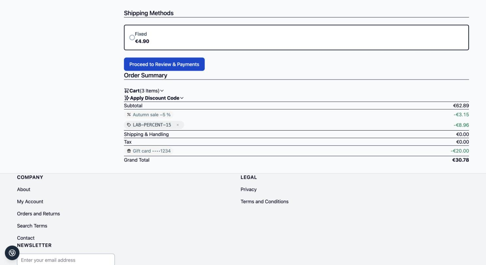

# Discount Lines for Hyvä Checkout

Renders one price summary line per discount (coupon, automatic rule, gift, free shipping) in
[Hyvä Checkout](https://hyva.io/hyva-checkout.html), using the data and display variant (A to D) provided by
[`pixelperfectat/magento2-module-discount-lines`](https://github.com/pixelperfectat/magento2-module-discount-lines).

## Requirements

- `pixelperfectat/magento2-module-discount-lines`
- Hyvä Checkout (commercial licence, not installed by this package)

## Installation

```bash
composer require pixelperfectat/magento2-module-discount-lines-hyva-checkout
bin/magento setup:upgrade
```

## How it works

- Replaces the template of the `price-summary.total-segment.discount` block. Without itemised lines (module
  disabled, or a quote without stored lines) the original Hyvä Checkout markup is rendered.
- Loads the base stylesheet `PixelPerfect_DiscountLines::css/discount-lines.css`. Colours come from the CSS custom
  properties `--pp-dl-chip-bg`, `--pp-dl-chip-ink`, `--pp-dl-auto-bg`, `--pp-dl-auto-ink` and `--pp-dl-save`;
  override them on `:root` in your theme.
- The remove button on a coupon chip calls `revokeCouponCode` on Hyvä Checkout's own `coupon-code` Magewire
  component, so the price summary refreshes as usual. The button is hidden when the discount code component is
  disabled in the Hyvä Checkout configuration.

## Variants

Set under Stores > Configuration > Sales > Discount Lines: A (label with chip below), B (chip as the label, default),
C (grouped block with "You save" total), D (quiet icon and monospace).

## Configuration

Configured in the base package under Stores > Configuration > Sales > Discount Lines (store-view scope):
`pp_discount_lines/general/enabled` (default `1`) and `pp_discount_lines/display/variant` (`A` to `D`, default `B`).
See the [base README](https://github.com/pixelperfectat/magento2-module-discount-lines#configuration) for the full table.

## Contract

The data this package renders (`extension_attributes.discount_lines`, row data key `discount_line`, the label rule
and the line kinds) is described in the
[contract section of the base README](https://github.com/pixelperfectat/magento2-module-discount-lines#contract-with-the-sales-email-module).

## Known limits

- Orders placed before the base module was installed keep the merged core row.
- Existing carts show the core row until the next totals collect.
- The Hyvä Checkout `discount` segment template is replaced; customisations of it must target the replaced block.
- Without itemised lines (module disabled, or a quote without stored lines) the original Hyvä Checkout markup is rendered.
- See the base README for the complete list of known limits.

## Screenshots

Placeholder data only, in `docs/screenshots/`:













## Development

```bash
composer install
composer check
```

## License

MIT, see `LICENSE`.
